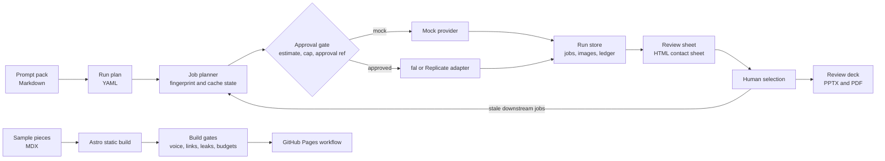

# Slop Editorial

An AI-native editorial studio toolkit: a multi-provider image pipeline with spend caps, approval gates, and provenance, plus a static site with automated quality gates.

[](https://monsieurgregorio2001-coder.github.io/slop-editorial/)

## In 30 seconds

- **Problem.** AI makes images nearly free, so publications drift into content that nobody decided to make.
- **Build.** A Python pipeline that estimates, caps, approves, and logs every paid generation. An Astro site whose build gates enforce voice, honesty, links, and speed.
- **Result.** Lighthouse scores 99 to 100 in all four categories on mobile, with 4.7 KB of gzipped JavaScript and 62 passing unit tests.

**Live demo:** https://monsieurgregorio2001-coder.github.io/slop-editorial/ (published by the Pages workflow once the repository is public).

All sample content in this repository is original and labelled as sample. The pipeline runs offline by default with a free mock provider, so nothing here needs an account, a key, or a network connection.

## What it demonstrates

**Taste.** Prompt packs carry a shared restraint block. Every candidate is reviewed in a contact sheet with written rejection criteria. The site voice is enforced mechanically. Taste is treated as a filter with a memory, not a mood.

**Editorial judgment.** The pipeline never picks for you. A person selects a candidate per prompt, and later prompts that depend on that choice regenerate while everything else stays cached. Rejections are part of the record.

**Critical thinking.** Every paid action is estimated, capped, approved, and logged. Unclear outcomes block resubmission instead of risking a double charge. The site refuses to build if its own rules are broken.

## Architecture



Two independent parts live in one repository.

| Part | Folder | Stack |
| --- | --- | --- |
| Generation pipeline `slopgen` | `pipeline/` | Python 3.10 or later, requests, Pillow, python-pptx, reportlab, PyYAML |
| Publication site | `site/` | Astro 7, MDX, TypeScript, Node 22.12 or later |

### Pipeline features

- Plan-driven jobs. Prompts live in Markdown and a YAML plan says which to run, which shared blocks to expand and which images feed which prompt.
- Content-addressed fingerprints over provider, model, final prompt, seed, size and the exact bytes of every reference image. An unchanged job is never paid for twice.
- Continuity. A prompt can use the selected candidate of an earlier prompt as a reference. Changing a selection marks only the downstream jobs stale.
- Spend controls. `plan` is free and prints an estimate. Paid runs need `--yes`, an `--approval-ref` and an estimate under `--max-usd`.
- Crash safety. The provider request id is saved the moment it exists and a restart polls it. A POST is never retried and an unclear outcome is recorded as `uncertain` until a person confirms.
- Provenance. An append-only JSONL ledger, per-job records with source file hashes and the git revision, relative paths only. A test asserts that no key or personal path reaches the run directory.
- Provider adapters isolate API details such as routing by reference count, price estimates and parameter overrides. Provider safety filters are respected: a withheld candidate is reported and never retried with weaker settings.

The fal and Replicate adapters follow the public API documentation and are tested against scripted fakes only. They have not been run against the live services.

### Site features

- Static output with critical CSS inlined, no third-party hosts, no analytics and no cookies.
- A build gate script that fails the build on voice violations, a missing sample notice, or broken internal links. It also catches leaked credentials, missing page structure, and blown size budgets.
- Hover-intent fetch-ahead with a priority queue and hard limits, plus a build-stamped service worker for repeat visits.
- Reduced motion applied before first paint, with an explicit toggle and a `?motion=reduce` switch.
- Design tokens with a dark scheme, and one component that changes mode through container queries.
- A real-browser verification script that drives Chrome through Playwright.

## Human-in-the-loop approval gates

The same pattern appears in both halves of the project. Automation proposes, a named person disposes, and the decision is written down.

A small generic example:

1. A designer asks for twenty candidate covers. `slopgen plan` prints the estimate: 20 jobs, 0.80 USD.
2. The studio lead reviews the estimate and records approval in the team tracker as `APPROVAL-0042`.
3. The designer runs `slopgen run --provider fal --yes --approval-ref APPROVAL-0042 --max-usd 1`. The run refuses to start without all three flags.
4. The ledger records the approval reference next to every request. Months later, anyone can answer who allowed the spend.
5. The editor picks one candidate with `slopgen select`. Only prompts that used the old pick regenerate, and only after another approved run.

The site follows the same rule at publish time: the gate script is the approver, and a deploy job runs only from the default branch.

## How to run

### Pipeline

```bash
cd pipeline
python3 -m pip install -r requirements.txt
python3 -m slopgen doctor                 # plan parses, which keys are present
python3 -m slopgen plan                   # job table and estimate, spends nothing
python3 -m slopgen all                    # free mock run: images, review sheet, deck
open runs/ai-and-taste/review.html        # contact sheet (macOS, use any browser elsewhere)
python3 -m slopgen select P1 2            # choose candidate 2 for P1, P2 and P3 go stale
python3 -m slopgen run                    # regenerates only the stale jobs
python3 -m unittest discover -s tests -t .
```

To use a real provider, export `FAL_KEY` or `REPLICATE_API_TOKEN` and pass `--provider fal` with the three approval flags. Keys are read from the environment or the macOS Keychain and are never written to disk by this project.

### Site

```bash
cd site
npm ci
npm run dev                # http://localhost:4321
npm run build
npm run check              # build gates over dist/
npm test                   # unit tests for the gate logic and helpers
CHROMIUM_PATH=/path/to/chrome npm run verify   # real-browser checks
CHROMIUM_PATH=/path/to/chrome node scripts/screenshots.mjs docs   # regenerate screenshots
```

## Deploying the site

The workflow in `.github/workflows/site.yml` builds the site with the repository name as its base path and runs the gates. It deploys to GitHub Pages from the default branch. It has not been run. Enable Pages with the GitHub Actions source in the repository settings before the first push.

## Tests and measured results

Measured on 14 October 2026 on one laptop. Treat these as a snapshot, not a benchmark.

| Check | Result |
| --- | --- |
| Python unit tests (`pipeline/`) | 49 pass |
| Node unit tests for gate logic and helpers (`site/`) | 13 pass |
| Real-browser checks in Chrome (`npm run verify`) | 11 pass |
| Site build gates (`npm run check`) | all pass, including voice, sample labelling, links, leaks, and budgets |
| Lighthouse, mobile preset, home page | 100 performance, 100 accessibility, 100 best practices, 100 SEO |
| Lighthouse, mobile preset, piece page | 99 performance, 100 accessibility, 100 best practices, 100 SEO |
| Largest contentful paint, home page | 1.8 s, with 0 layout shift and 0 ms blocking time |
| JavaScript shipped | 4.7 KB gzipped |
| Mock pipeline, 8 candidates plus review sheet plus deck | 1.2 s cold, 0.23 s when fully cached |

## Credits

- Fonts: Fraunces, Inter, and JetBrains Mono, self-hosted as latin subsets under the SIL Open Font License 1.1.
- Built by Garfield Greg Lim III.

## Limits and honesty

- The sample essays are short and exist to exercise the site, not to make claims about the industry.
- The mock provider draws abstract placeholder frames. They prove the plumbing, not image quality.
- Live provider behavior, prices and model names change. Treat the price tables as planning figures.

## Licence

MIT. Copyright 2026 Garfield Greg Lim III. See `LICENSE`.
