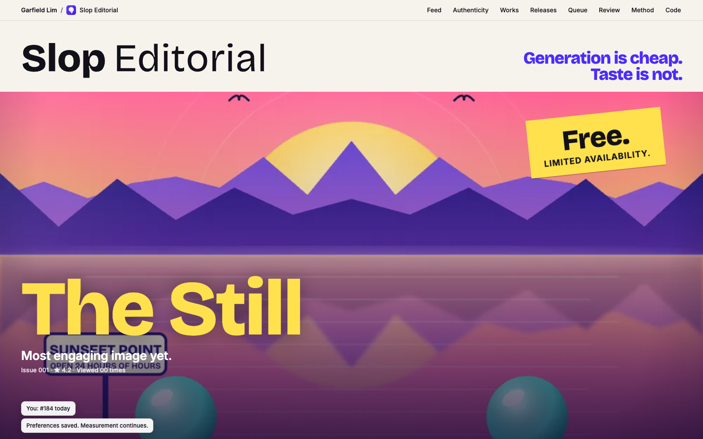
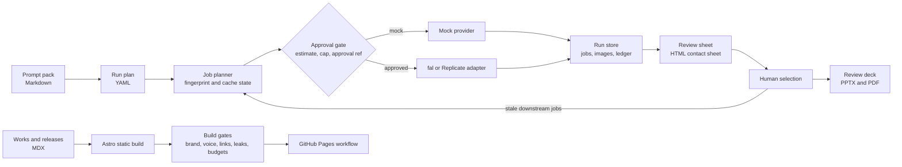

# Slop Editorial

A deadpan satire of AI slop and the attention economy, built as software: six-finger hands, signs that say Sunseet, prompts printed on the picture, and comments that all say Amazing. Hung like an exhibition: warm paper, framed prints, wall labels that list the metrics where the medium should be. Backed by an image pipeline that keeps a human in the loop.

[](https://monsieurgregorio2001-coder.github.io/slop-editorial/)

## In 30 seconds

- **Problem.** AI makes images nearly free, so feeds fill with content nobody decided to make. Hands get six fingers, and every comment says Amazing.
- **Build.** An Astro site that hangs nine generated works like a gallery and labels them like the platforms it mocks (cookie sheet, visitor number, ratings that always read 4.2, a gift shop that arrives in front of the gold). Beside it, a Python pipeline that estimates, caps, approves, and logs every paid generation.
- **Result.** 243 real-browser checks, 144 build gates, 40 site tests, 56 pipeline tests and 1,536 parity fixtures pass. CI runs all of them.

**Live demo:** https://monsieurgregorio2001-coder.github.io/slop-editorial/

The thesis is one line: **Generation is cheap. Taste is not.** It mocks platforms, incentives and the output, never people. Every image was generated from a written brief with an image model, then checked by a person against that brief ([owner confirmation, 2026-10-28](docs/review-record.md); six digits, three suns, readable text). The certificate is a generated photograph with a CSS light sweep. The pipeline runs offline by default with a free mock provider, so nothing here needs an account, a key, or a network connection.

## The ten behaviours

The unlinked `/review/` page on the running site lists the same behaviours (noindex, not in navigation). Metrics, ratings, ranks, and prices are staged and live in the browser only.

| # | Behaviour | Where | What happens |
| --- | --- | --- | --- |
| 1 | The front of the gallery | `/` | A masthead, the still in a frame with its sticker (Free. Limited availability.), and a wall label: medium, edition 1 of 48,291, the prompt as provenance. A cookie sheet at 2.6 s offers Accept all and Accept all. The visitor line reads Visitor no. 184 today. |
| 2 | Beautiful, then wrong | `/feed/` | The still, then its label. The metrics arrive: engagement improved 18 %, preferred by people who skip, this image performed well. |
| 3 | One interface joke | `/feed/` | Your taste has 1 update available, to delve into the rich tapestry of what you already like. Not now sets a reminder. Install runs a progress bar and ends: Installed. No visible difference. |
| 4 | One embarrassment | `/feed/`, `/` | Stop on the image for 7 s: You have been looking for 0:07. That is above average. |
| 5 | One banal object ruining luxury | `/authenticity/` | A gilded Certificate of Human Touch stands on a plinth as a generated photograph, and a CSS light sweep crosses it as you scroll. The gift shop arrives in front of it: crowd barrier, a laminated PLEASE DO NOT GENERATE, sanitizer, a terminal reading TAP TO APPRECIATE 2.00, a prompt pack at 14.99, an extra finger at 2.99, and a watermark remover remover. Originality. From 0/month. |
| 6 | A catalogue, not a feed | `/works/`, `/authenticity/` | The archive is an exhibition of nine works (six fingers, prompt residue, a refusal listing, engagement bait, a tokenmaxxer award, delve, a thirsty data center, a certificate) with a plate number, rating, views and price in each label. The buy bar adds prompt packs and the receipt itemizes what you appreciated. |
| 7 | The viewer becomes the joke | `/feed/` | Every action improves your visitor number. Scroll, hold, install an update: the number drops and the system thanks you. Your taste has been updated. |
| 8 | Mobile interaction | `/feed/` on a phone | Hold the image. A ring fills in 0.9 s: Appreciation registered. Free shipping on redemption. |
| 9 | Reduced motion | `/?motion=reduce` | Delays and staging collapse. Sticker, shop, and buy bar sit in their finished state. Counters hold still. |
| 10 | Unexpectedly playful | `/authenticity/` | The gift shop works. The pack adds up, the receipt itemizes, and you are thanked for appreciating. |

Two more pages demonstrate human-in-the-loop gates. `/releases/` tracks six sample releases like an order, each with a spend estimate, a cap, and an approval reference. `/queue/` is the approval queue, and its buttons refuse on purpose: *Approval happens with a human, not a button.* Its help box says: I understand your frustration. Would you like to speak to an agent? I am the agent.

## Architecture



| Part | Folder | Stack |
| --- | --- | --- |
| Generation pipeline `slopgen` | `pipeline/` | Python 3.10 or later, requests, Pillow, python-pptx, reportlab, PyYAML |
| Publication site | `site/` | Astro 7, MDX, TypeScript, GSAP ScrollTrigger on the feed, motion, house 2.0.1, Node 22.12 or later |

### Site features

- Static output at the `/slop-editorial/` base, critical CSS inlined, no third-party hosts, no analytics, and no cookies.
- View Transitions with a shared element between the cover and the feed. Scroll sequences are scrubbed by GSAP ScrollTrigger with no pinning tricks, no wheel capture, and no scroll hijack.
- The shared house crumb and footer, joined at build by `house-sync` and pinned in `site/house.lock.json`. Links to the hub and other rooms reload the document so the doorway can run. The room follows the OS colour scheme, and the footer Room toggle overrides it.
- Fetch-ahead on hover or touch with a priority queue and hard limits, plus a build-stamped service worker for repeat visits.
- Reduced motion applied before first paint, from the OS setting, the Room motion toggle, the house Calm switch, or `?motion=reduce`. Light and dark schemes from design tokens.
- The nine works were generated with an image model and shipped as WebP. The wordmark is outlined from the font by `scripts/make-logo.py`. Fonts are self-hosted under the SIL Open Font License (`public/OFL.txt`).
- Build gates that fail on the old brand, external requests, em dashes, semicolons, contractions, long sentences, broken links, leaks, and blown budgets. A real-browser suite drives headless Chrome through Playwright.

### Pipeline features

- Plan-driven jobs. Prompts live in Markdown and a YAML plan says which to run, which shared blocks to expand and which images feed which prompt.
- Content-addressed fingerprints over provider, model, final prompt, seed, size and the exact bytes of every reference image. An unchanged job is never paid for twice.
- Continuity. A prompt can use the selected candidate of an earlier prompt as a reference. Changing a selection marks only the downstream jobs stale.
- Spend controls. `plan` is free and prints an estimate. Paid runs need `--yes`, an `--approval-ref` and an estimate under `--max-usd`.
- Crash safety. The provider request id is saved the moment it exists and a restart polls it. A POST is never retried and an unclear outcome is recorded as `uncertain` until a person confirms.
- Provenance. An append-only JSONL ledger, per-job records with source file hashes and the git revision, relative paths only. A test asserts that no key or personal path reaches the run directory.
- Provider adapters isolate API details such as routing by reference count, price estimates and parameter overrides. Provider safety filters are respected: a withheld candidate is reported and never retried with weaker settings.

The fal and Replicate adapters follow the public API documentation and are tested against scripted fakes only. They have not been run against the live services.

## Human-in-the-loop approval gates

The same pattern appears in both halves of the project. The tool suggests. A named person approves, and the approval is logged.

A small generic example:

1. A designer asks for twenty candidate covers. `slopgen plan` prints the estimate: 20 jobs, 0.80 USD.
2. The studio lead reviews the estimate and records approval in the team tracker as `APPROVAL-0042`.
3. The designer runs `slopgen run --provider fal --yes --approval-ref APPROVAL-0042 --max-usd 1`. The run refuses to start without all three flags.
4. The ledger records the approval reference next to every request. Months later, anyone can answer who allowed the spend.
5. The editor picks one candidate with `slopgen select`. Only prompts that used the old pick regenerate, and only after another approved run.

The site demonstrates the same rule in its `/releases/` tracker and `/queue/` approval queue. Every sample release shows an estimate, a cap and an approval reference, and the Approve button refuses: approval happens with a human, not a button.

## How to run

### Pipeline

```bash
cd pipeline
python3 -m pip install -r requirements.txt
python3 -m slopgen doctor                 # plan parses, which keys are present
python3 -m slopgen plan                   # job table and estimate, spends nothing
python3 -m slopgen all                    # free mock run: images, review sheet, deck
open runs/ai-and-taste/review.html        # contact sheet (macOS, use any browser elsewhere)
python3 -m slopgen select P1 2            # choose candidate 2 for P1, P2 and P3 go stale
python3 -m slopgen run                    # regenerates only the stale jobs
python3 -m unittest discover -s tests -t .
```

To use a real provider, export `FAL_KEY` or `REPLICATE_API_TOKEN` and pass `--provider fal` with the three approval flags. Keys are read from the environment or the macOS Keychain and are never written to disk by this project.

### Site

```bash
cd site
npm ci
npm run dev                # http://localhost:4321/slop-editorial/
npm run build
npm run check              # build gates over dist/
npm test                   # unit tests for the gate logic and helpers
npm run verify             # real-browser checks in headless Chrome, axe in light and dark
npm run art                # redraw the old SVG studies into art-src/render. It cannot write to public/img
npm run house:check        # fail when a built page drifts from the pinned house
npm run screenshots        # review screenshots, README hero, card, and Open Graph image
```

`verify` and `screenshots` use Google Chrome. They look for it at the macOS default path and honour `CHROMIUM_PATH`.

## Deploying the site

The workflow in `.github/workflows/site.yml` builds the site with the repository name as its base path and runs the gates. It deploys to GitHub Pages from the default branch on every push, and has done so since 14 October 2026.

## Tests and measured results

Each count below comes from a run on 28 October 2026 at the commit that adds the spend cap. CI runs every suite on each push and writes the same counts to `evidence.json`.

| Check | Result |
| --- | --- |
| Python unit tests (`pipeline/`) | 56 pass |
| Node unit tests for gate logic, helpers, the spend cap port and the receipt (`site/`) | 40 pass |
| Spend cap parity: Python and TypeScript on generated fixtures (`site/test/fixtures/spend-parity.json`) | 1,536 of 1,536 agree |
| Real-browser checks in Chrome (`npm run verify`) | 243 pass, 0 fail |
| Axe accessibility, 10 page types at 390 and 1440 in light and dark (part of `npm run verify`) | 40 runs, 0 violations |
| Site build gates (`npm run check`) | 144 checks pass |
| JavaScript before interaction, gzipped (budget gate in `npm run check`) | 10.6 KB on the home page (budget 15), 11.3 KB on the certificate page (budget 20) |
| Horizontal scroll at 360 px, full motion and Calm (part of `npm run verify`) | none on all 10 page types |
| Layout shift on the home page and the certificate page at 390 and 1280, cookie sheet included | 0 |

## The spend cap

The Method page at `/about/` runs the pipeline's cost check in the browser. `pipeline/slopgen/spend.py` holds the price table, the estimate and the cap check as pure functions, and the runner calls them. `site/src/lib/spend.ts` is a TypeScript port. `python -m slopgen.spend_fixtures` writes the parity fixtures, a Python test fails when the committed file is stale, and a Node test replays every row through the port. `python -m slopgen.mock_record` runs the pipeline with the free mock provider and writes the committed record shown beside the toy. Nothing here calls a paid provider.

## Credits

- Fonts: Bricolage Grotesque, Inter, and JetBrains Mono, self-hosted as latin subsets under the SIL Open Font License 1.1.
- Built by Garfield Greg Lim III.

## Limits and honesty

- The works are short original satire about widely known AI slop tropes. They name no brands, products, or people, and make no claims about the industry.
- Release figures on `/releases/` and `/queue/` are sample data from the free mock provider.
- Paid providers were tested against fakes only. The current nine plates have no generation record.
- The spend cap page shows a planning estimate from the pipeline's price table. The provider invoice governs.
- The mock provider draws abstract placeholder frames. They prove the plumbing, not image quality.
- Live provider behavior, prices and model names change. Treat the price tables as planning figures.

## Licence

MIT. Copyright 2026 Garfield Greg Lim III. See `LICENSE`.

## Development conventions

Start with [local project context](docs/CONTEXT.md) and [agent instructions](AGENTS.md). Shared structure, review, and spec practices live in the [portfolio hub repository](https://github.com/monsieurgregorio2001-coder/monsieurgregorio2001-coder.github.io), under CONTRIBUTING.md and docs/portfolio/. Small fixes use a short verification record. Material behavior changes use a focused spec.
